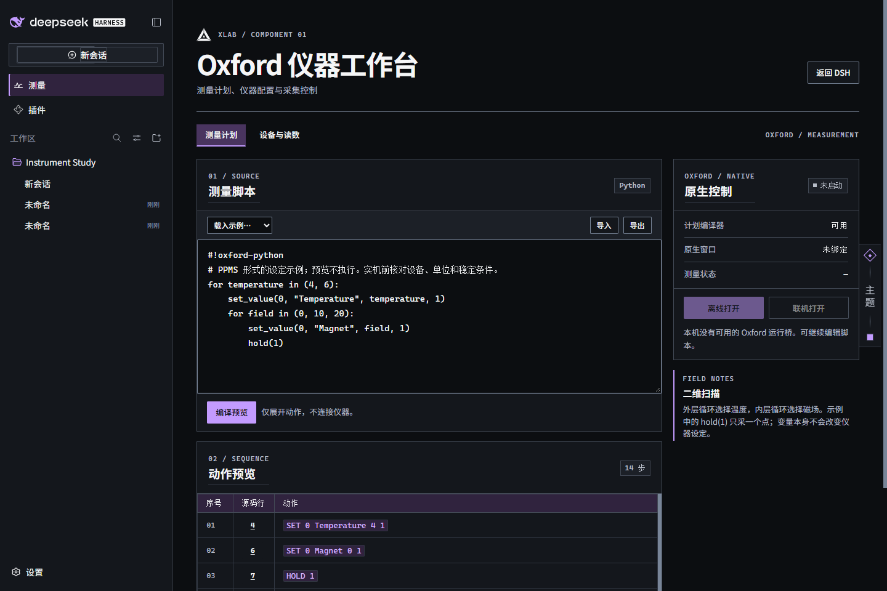

# Oxford · 仪器工作台

Windows 桌面版在 **应用 → 编辑** 两个顶栏项目后增加第三项 **测量**。点「测量」打开工作台，再点一次或点「返回 DSH」回到之前的对话/多栏。Web 版没有这条 Windows 菜单，使用侧栏的「测量」。切换页面不会开始、暂停或结束采集。

**测量计划**可以编写、导入、导出 UTF-8 Python 脚本。在「载入示例」里选择二维设定示例，点「编译预览」：两个温度各扫三个磁场点，展开成 14 个动作；点击源行号可回到脚本。编译器使用 CPython 的语法树，只解释测量语言支持的语句，编译不连接设备。支持赋值、有限嵌套循环、条件、算术、`range`、`linspace` 及 `hold`、`delay`、`sampling`、`set_value`、`save`、`wait_for`；不运行任意 Python 程序。

**设备与读数**仅显示原生桥报告的设备和最近样本。无原生程序也能编辑、编译和预览，界面不会把示意图当作已连接设备。显示「联机模式」不等同于每台仪器都已连接。

## 安装和连接

1. 按[主仓库说明](../README.md)安装四个 bundle，打开 DSH。在 Windows 默认使用随 DSH 分发的 Python；如安装位置不同，可将环境变量 `DSH_OXFORD_PYTHON` 设为可信 Python 3 可执行文件的绝对路径后重新启动。不需要 pip 依赖。
2. 要测量，在实验室电脑准备兼容的 **Oxford 1.3.1.0** 和所需驱动。普通 1.3.0 不支持此协议。[原生适配说明](../native/README.md)提供接入现有工程的方法。代码库不分发供应商 VISA 驱动、实验室仪器配置或凭据。
3. 在工具箱目录绑定可信的本机程序，示例：`./bind-oxford.ps1 -Executable 'D:\Oxford\app\Oxford.exe'`。绑定记录写入当前 DSH Home 的 `toolkit/oxford.json`，包括文件哈希；更换构建后需要重新绑定。绑定本身不会打开应用。
4. 在工作台先选「离线打开」检查配置。需要采集时，结束并关闭离线窗口，再选择「联机打开」。在原生窗口核对通道、范围、速率和保存位置；工作台可启用当前脚本，随后开始、暂停、恢复或结束。覆盖文件、设备互斥和停止逻辑仍走 Oxford 自身的控制流程。改过脚本必须重新启用。

如果操作系统阻止原生程序运行，页面仍能编译计划；请使用实验室允许的构建。退出 DSH 不会强行杀掉正在工作的原生程序，仍可在 Oxford 本身停止采集。

## 主题与实现

在「设置 → 通用 → 视觉协议」选择[罗德岛白昼](../docs/images/oxford-day.png)、[罗德岛黑夜](../docs/images/oxford-night.png)、[终末地玻璃](../docs/images/oxford-glass.png)或 xLab 控制台。测量页直接使用当前宿主主题；已打开的兼容原生窗口也接收同一协议的色板。

工作台通过 DSH 自身的会话认证访问本机 Host。原生桥通过 DSH 启动的 Oxford 子进程专用标准流传递有限操作，不开放仪器 TCP 服务，不接受浏览器指定的程序路径或任意命令。`workbench.js`、`workbench.css`、`menu.js` 是编辑源，修改后运行 `node tools/build-oxford.mjs` 产生 DSH 加载的 `client.js`。
